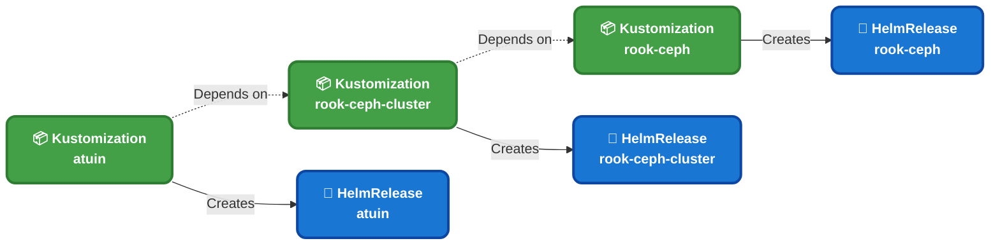

<div align="center">


### A _slightly overengineered_ homelab 

_... managed with [Flux](https://github.com/fluxcd/flux2), [Renovate](https://github.com/renovatebot/renovate), and [GitHub Actions](https://github.com/features/actions)_ 

</div>

<div align="center">

[](https://status.k13.dev)&nbsp;&nbsp;
[](https://status.k13.dev)&nbsp;&nbsp;
[](https://status.k13.dev)

</div>

<div align="center">

[](https://discord.gg/home-operations)&nbsp;&nbsp;
[](https://talos.dev)&nbsp;&nbsp;
[](https://kubernetes.io)&nbsp;&nbsp;
[](https://fluxcd.io)&nbsp;&nbsp;


</div>

<div align="center">

[](https://github.com/home-operations/kromgo)&nbsp;&nbsp;
[](https://github.com/home-operations/kromgo)&nbsp;&nbsp;
[](https://github.com/home-operations/kromgo)&nbsp;&nbsp;
[](https://github.com/home-operations/kromgo)&nbsp;&nbsp;
[](https://github.com/home-operations/kromgo)&nbsp;&nbsp;
[](https://github.com/home-operations/kromgo)&nbsp;&nbsp;
[](https://github.com/home-operations/kromgo)&nbsp;&nbsp;
[](https://github.com/home-operations/kromgo)

</div>

---

##  Overview

This repository holds all of the configuration for my home Kubernetes cluster and the workloads that run on it. Every resource of the cluster is code, from the operating system to the Helm release of each application. The cluster applies changes to this code automatically.

The stack is simple on purpose, and you can build it again from this repository:

- [Talos Linux](https://github.com/siderolabs/talos): a read-only, API-managed operating system for Kubernetes.
- [Flux](https://github.com/fluxcd/flux2): continuous sync of the cluster with this repository.
- [Renovate](https://github.com/renovatebot/renovate): automatic dependency updates for the whole cluster.
- [GitHub Actions](https://github.com/features/actions): tests and automation on every commit.

The cluster can recover from a full loss. If you erase every disk in the rack, the cluster comes back within minutes. The applications run again and the persistent data is intact, with no manual steps. The cluster continues from the point where it stopped.

To build a similar cluster, start with [onedr0p/cluster-template](https://github.com/onedr0p/cluster-template).

---

##  Repository Layout

```sh
📁 bootstrap     # One-time cluster bootstrap (helmfile + kustomize)
📁 kubernetes    # Everything that Flux applies
├─📁 apps        # Workloads, grouped by namespace
├─📁 components  # Reusable Kustomize components (alerts, kopiur, etc.)
📁 talos         # Talos machine configuration and overrides for each node
```

---

##  Cluster

The cluster has three Kubernetes nodes on bare-metal [MS-A2](https://store.minisforum.com/products/minisforum-ms-a2) workstations. It is semi hyper-converged: the same nodes run the workloads and most of the storage. [Rook Ceph](https://github.com/rook/rook) keeps the persistent storage inside the cluster. A dedicated TrueNAS server keeps the bulk media and shares it over NFS.

### Core components

- [actions-runner-controller](https://github.com/actions/actions-runner-controller): self-hosted GitHub runners for CI/CD workflows.
- [cert-manager](https://github.com/cert-manager/cert-manager): automatic issue and renewal of SSL certificates.
- [cilium](https://github.com/cilium/cilium): container networking with [eBPF](https://ebpf.io).
- [cloudflared](https://github.com/cloudflare/cloudflared): a tunnel to cluster services through Cloudflare, which protects them.
- [envoy-gateway](https://github.com/envoyproxy/gateway): the ingress controller for traffic into the cluster.
- [external-dns](https://github.com/kubernetes-sigs/external-dns): automatic DNS records for the ingress resources.
- [external-secrets](https://github.com/external-secrets/external-secrets): Kubernetes secrets from [1Password](https://1password.com).
- [kopiur](https://github.com/home-operations/kopiur): backup and recovery for persistent volume claims.
- [multus](https://github.com/k8snetworkplumbingwg/multus-cni): extra network interfaces for pods.
- [rook](https://github.com/rook/rook): distributed storage for persistent volumes.
- [spegel](https://github.com/spegel-org/spegel): a stateless OCI registry mirror inside the cluster, for faster image pulls.

### GitOps workflow

Flux watches the [kubernetes](./kubernetes) directory. On every commit, Flux makes the cluster match it in these steps:

1. Flux scans [kubernetes/apps](./kubernetes/apps) and all of its subdirectories, and reads each top-level `kustomization.yaml`.
2. Each of these entry points usually declares a `Namespace` and one or more Flux `Kustomization` resources (`ks.yaml`).
3. Each Flux `Kustomization` creates a `HelmRelease`, or raw manifests, for an application.
4. Flux applies them in the order of their dependencies. For example, nothing in `rook-ceph` deploys until its prerequisites are healthy.



---

##  Networking

The home network has several tiers and uses UniFi hardware. The UDM Beast does the routing and the firewall between the LAN and the 5Gbps WAN from RCN. A 25G aggregation switch is the backbone. It connects to the NAS with 25G LACP and to each Kubernetes node with 10G LACP. A 24-port PoE+ switch connects the wired clients and the access points.

```mermaid
graph LR
    %% Class Definitions
    classDef wan fill:#f87171,stroke:#fff,stroke-width:2px,color:#fff,font-weight:bold;
    classDef core fill:#60a5fa,stroke:#fff,stroke-width:2px,color:#fff,font-weight:bold;
    classDef agg fill:#34d399,stroke:#fff,stroke-width:2px,color:#fff,font-weight:bold;
    classDef switch fill:#a78bfa,stroke:#fff,stroke-width:2px,color:#fff,font-weight:bold;
    classDef device fill:#facc15,stroke:#fff,stroke-width:2px,color:#000,font-weight:bold;
    classDef vlan fill:#1f2937,stroke:#fff,stroke-width:1px,color:#fff,font-size:12px;

    %% Nodes
    RCN[🛜 RCN<br/>5Gbps WAN]:::wan
    UDM[📦 UDM Beast]:::core
    AGG[🔗 Pro Aggregation XG]:::agg
    NAS[💾 NAS]:::device
    K8s[☸️ Kubernetes<br/>3 Nodes]:::device
    SW[🔌 Pro XG 24 PoE]:::switch
    DEV[💻 Devices]:::device
    WIFI[📶 WiFi Clients]:::device

    %% Subgraph for VLANs
    subgraph VLANs [LAN +vlan]
        direction TB
        LOCAL[LOCAL<br/>192.168.0.0/24]:::vlan
        TRUSTED[TRUSTED*<br/>192.168.1.0/24]:::vlan
        SERVERS[SERVERS*<br/>192.168.10.0/24]:::vlan
        SERVICES[SERVICES*<br/>192.168.20.0/24]:::vlan
        IOT[IOT*<br/>192.168.30.0/24]:::vlan
        GUEST[GUEST*<br/>192.168.40.0/24]:::vlan
    end

    style VLANs fill:#111,stroke:#fff,stroke-width:2px,rx:0,ry:0,padding:20px;

    %% Links
    SERVERS -.-> RCN
    RCN -.->|WAN| UDM
    UDM -- 25G --- AGG
    UDM -- 25G --- SW
    AGG -- 10G LACP --> K8s
    AGG -- 25G LACP --> NAS
    SW --> DEV
    SW --> WIFI

    %% Keep SERVERS->RCN as a hidden layout constraint and style bonded links thicker
    linkStyle 0 stroke:transparent,stroke-width:0px,color:transparent;
    linkStyle 2 stroke-width:4px;
    linkStyle 3 stroke-width:4px;
    linkStyle 4 stroke-width:2px;
    linkStyle 5 stroke-width:4px;
```



### DNS

Two [ExternalDNS](https://github.com/kubernetes-sigs/external-dns) instances manage the DNS records. The private instance syncs every route to the UDM Beast through the [ExternalDNS UniFi webhook](https://github.com/kashalls/external-dns-unifi-webhook). The public instance syncs the routes on the `external` Gateway to Cloudflare.

The result is split-horizon DNS, which gives different answers inside and outside the home. At home, public hostnames resolve to LAN IPs. Traffic from home to my own services thus never leaves the network.

---

##  Hardware

<details>
  <summary>Click to see my rack</summary>

  
</details>

| Device                       | Count | OS Disk    | Data Disk                  | RAM   | OS            | Purpose              |
| ---------------------------- | ----- | ---------- | -------------------------- | ----- | ------------- | -------------------- |
| Minisforum MS-A2             | 3     | 1.92TB M.2 | 3.84TB U.2 + 1.92TB M.2    | 96GB  | Talos         | Kubernetes           |
| 45HomeLab HL15 2.0           | 1     | 1.92TB M.2 | 12×22TB HDD + 2×7.68TB U.2 | 512GB | TrueNAS SCALE | NFS + Backup Storage |
| JetKVM                       | 3     | -          | -                          | -     | -             | KVM for Kubernetes   |
| UniFi Dream Machine Beast    | 1     | -          | 2×960GB SSD                | -     | UniFi OS      | Router & NVR         |
| UniFi Pro XG Aggregation     | 1     | -          | -                          | -     | UniFi OS      | 25G SFP28 Switch     |
| UniFi Pro XG 24 PoE          | 1     | -          | -                          | -     | UniFi OS      | 10G PoE+ Switch      |
| UniFi Power Distribution Pro | 1     | -          | -                          | -     | UniFi OS      | PDU                  |
| APC SMT1500RM2UNC UPS        | 1     | -          | -                          | -     | -             | UPS                  |

### MS-A2 build

Each MS-A2 workstation (AMD Ryzen™ 9 9955HX) has these parts:

- [Crucial 96GB Kit (48GBx2) DDR5-5600 SODIMM](https://www.amazon.com/dp/B0C79K5VGZ)
- [Samsung 1.92TB M.2 22x110mm PM9A3 NVMe PCIe 4.0](https://www.amazon.com/dp/B0B23N4P7L)
- [Samsung 3.84TB U.2 PM9A3 NVMe PCIe 4.0](https://www.amazon.com/dp/B0B83W15X6)
- [Google Coral M.2 Accelerator A+E Key](https://www.amazon.com/dp/B0DFMC1GQF)

---

##  Thanks

Thank you to [@onedr0p](https://github.com/onedr0p) and the [Home Operations](https://discord.gg/home-operations) Discord community. Their help and their patterns made this cluster possible. For more examples of apps in a homelab, browse [kubesearch.dev](https://kubesearch.dev).

---

<div align="center">

[](https://deepwiki.com/buroa/home-ops)

</div>
